<!-- Perfil GitHub de Thiago Pantoja. Itens marcados com TODO precisam ser preenchidos antes de publicar. -->

### Olá, Eu projeto sistemas que escalam e experiências que se movem.

Arquiteto de software e engenheiro de plataformas na **[Easynext](https://easynext.cloud)**. Trabalho onde engenharia, dados e design se encontram: da arquitetura de plataformas e pipelines de dados ao front-end com motion design, passando por estratégia de marketing digital e mentoria de desenvolvedores.

### Áreas de atuação

| | |
|---|---|
| **Arquitetura & System Design** | sistemas distribuídos, APIs, modelagem de dados, decisões de trade-off documentadas |
| **Platform Engineering** | infraestrutura como código, CI/CD, plataformas internas de desenvolvimento, observabilidade |
| **Engenharia de Dados & BI** | pipelines, data lakehouse, modelagem dimensional, Qlik Sense |
| **Front-end & Motion** | Next.js, React, TypeScript, animações e microinterações |
| **Marketing digital** | sites de alta conversão, SEO técnico, conteúdo audiovisual |

### Stack

<!-- TODO: revise a lista — remova o que não usa no dia a dia -->

   
   
  

### Projetos em destaque

<!-- TODO: torne o repositório público ou substitua por outros projetos -->
- **[VideoMaker Portfolio](https://github.com/thiagorpantojaarchitect/videomaker-portfolio)** — portfólio cinematográfico em Next.js 15, React 19 e TypeScript, com design system próprio e estética de monitor de cinema.

### Contato

<!-- TODO: substitua os links do LinkedIn, Instagram e o número do WhatsApp -->

  
  
  
  

